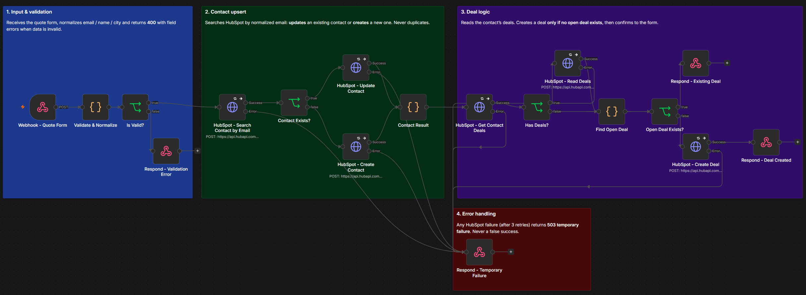
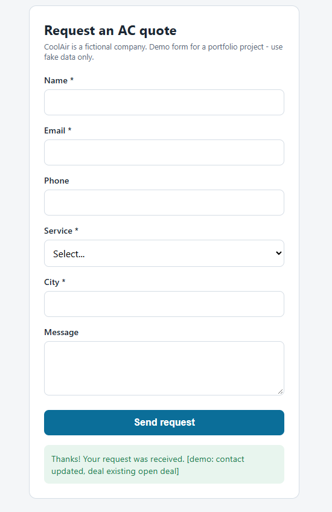
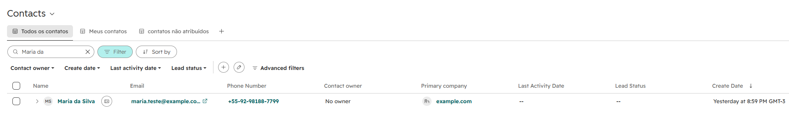

# LeadFlow — Lead Capture & CRM Automation (n8n + HubSpot)

> **Independent demo project.** "CoolAir" is a fictional air-conditioning company and every record shown here is synthetic. No real customer data was used.

Automates incoming quote requests: a web form sends the lead to **n8n**, which validates and normalizes the data, **creates or updates the contact in HubSpot without duplicates**, opens a deal only when needed, and tells the form exactly what happened.



▶️ **[Watch the 2-minute demo video](https://youtu.be/rGSIWt6hlAQ)**: a new lead, then the same person submitting again, with no duplicates in HubSpot.

## Problem

A small service company receives quote requests through its website. Today someone copies each request into the CRM by hand, so:

- the same person often ends up as two or three contacts;
- every resubmission risks creating another deal;
- typos and messy formatting (`  MARIA.Teste@Example.COM `) slip into the CRM;
- when something fails, nobody knows whether the request was saved.

## Solution

```text
[Quote form] --POST--> [n8n Webhook]
                          |
                  Validate & normalize ──invalid──> 400 + field errors
                          |
              Search HubSpot contact by email
                 ├─ found ──> update contact
                 └─ not found ──> create contact (lifecycle stage: lead)
                          |
              Read the contact's associated deals
                 ├─ open deal exists ──> keep it (no new deal)
                 └─ no open deal ──> create deal + associate to contact
                          |
                   200 "request received"

Any HubSpot error (after 3 attempts) ──> 503 "temporary failure" (never a false success)
```

## Stack

| Tool | Role |
|---|---|
| **n8n** (self-hosted, Docker) | Webhook, validation, orchestration, retries, error routing |
| **HubSpot CRM** (free) | Contacts and deals — the **source of truth** |
| **HubSpot REST API** (CRM v3/v4) | Called through n8n HTTP Request nodes |
| **HTML + JavaScript landing page** | Fictional company site whose quote form posts JSON to the webhook |
| **ngrok** | Exposes the local n8n webhook over HTTPS for the demo |

## Design decision: HTTP Request instead of the native HubSpot node

n8n ships a HubSpot node that covers basic contact and deal operations. This workflow calls the HubSpot REST API through **HTTP Request** nodes instead, because:

1. **Explicit error handling.** The core requirement is *never return a false success*. HTTP Request exposes the exact status code (401, 409, 429, 5xx) and routes every failure to a single error output, with predictable retries.
2. **Endpoints the native node doesn't cover well.** Checking for an open deal uses the **Associations v4 API** and a **batch read** of deals.
3. **Transparency.** Each node shows exactly which endpoint and payload is sent, which makes the flow easier to debug and audit.
4. **Portability.** The same approach works for any REST API, not only services that have a ready-made n8n node.

**Trade-off:** the native node is faster to set up and easier for non-developers to maintain. For a simple "create contact" flow it would be a perfectly good choice.

## Reliability

| Concern | How it is handled |
|---|---|
| Invalid input | Name, email, service type and city are validated server-side; the form receives a `400` with per-field errors. |
| Messy data | Email is trimmed and lowercased; name and city are title-cased (`maria da silva` → `Maria da Silva`); phone keeps digits only. |
| Duplicate contacts | The contact is looked up by normalized email before writing — existing contacts are **updated**, never re-created. |
| Duplicate deals | A deal is created only if the contact has **no open deal**. Closed (won/lost) deals don't block a new one, so returning customers still get a new deal. |
| Data loss on update | Empty form fields are not sent to HubSpot, so a resubmission without a phone number never erases the stored one. |
| API failures | Every HubSpot call retries 3 times (1.5 s apart). If it still fails, the form gets a `503` and a "try again" message — **never a false success**. |
| Retry after failure | Because every step checks current CRM state first, resubmitting after a failure completes the missing steps without duplicating what was already saved. |
| Secrets | The HubSpot service key lives only in n8n credentials (least-privilege CRM scopes, restricted to `api.hubapi.com`). The webhook URL lives in a git-ignored `config.js`. |

## Business rules

- **Email is required** — it is the deduplication key.
- **One open deal per contact.** A new request from someone who already has an open deal updates the contact but does not open a second deal; the sales rep handles it in the existing deal.
- **Latest submission wins** for contact fields (e.g. if the person enters a new city, HubSpot keeps the newest value).
- **First-touch lead source.** `lead_source` is written only when the contact is created, so a returning lead keeps its original source. Unknown sources are stored as `other`. `service_type` always reflects the latest request.
- New deals go to the first stage of the default pipeline, named like `AC Installation - Maria Teste (Manaus)`.

## Test scenarios

All tests were run with synthetic data against a HubSpot free account.

| # | Scenario | Expected | Result |
|---|---|---|---|
| 1 | New valid lead | Contact created, deal created | ✅ Pass |
| 2 | Same email submitted again | Same contact updated, existing open deal kept (no duplicates) | ✅ Pass |
| 3 | Email with spaces / uppercase | Recognized as the same contact | ✅ Pass |
| 4 | Invalid email or empty required field | `400`, field errors shown on the form, nothing sent to HubSpot | ✅ Pass |
| 5 | HubSpot API failure (invalid credential) | `503` "temporary failure", no false success | ✅ Pass |
| 6 | Resubmission after a failure | Existing contact reused, missing deal created, no duplicates | ✅ Pass |




## Setup

1. **HubSpot:** create a *service key* with these scopes:
   `crm.objects.contacts.read/write`, `crm.objects.deals.read/write`, `crm.schemas.contacts.read`, `crm.schemas.deals.read`.
2. **HubSpot custom contact properties** (dropdown select):
   - `lead_source`: `website`, `referral`, `google_ads`, `social_media`, `other`
   - `service_type`: `installation`, `maintenance`, `repair`, `inspection`, `quote`
3. **n8n:** create a **Header Auth** credential — Name `Authorization`, Value `Bearer <your-service-key>`.
4. Import `workflow.example.json` and select that credential in the six `HubSpot -` HTTP Request nodes.
5. Activate the workflow (webhook path: `/webhook/leadflow`).
6. **Form:** copy `form/config.example.js` to `form/config.js`, set your webhook URL, and open `form/index.html` in a browser.

## Limitations

- **Demo, not production.** Built and tested with synthetic data on HubSpot's free plan.
- **Search indexing delay:** HubSpot's search API can take a few seconds to return a newly created contact. Two submissions of the same email within seconds may make the second one fail with a "temporary failure" (HubSpot rejects the duplicate email), which is safe but not ideal. A production version could catch the `409 Conflict` and update the existing contact instead.
- **No persistent audit log yet.** Execution history lives in n8n. Writing a sanitized log to a sheet/database is covered in Project 2.
- **No spam protection** (captcha, rate limiting) on the demo form.
- **Consent and data protection** (GDPR/LGPD) would need to be addressed before handling real leads.

## Possible extensions

- One open deal **per service type** instead of per contact.
- Accept phone-only leads with a secondary deduplication key.
- Assign deals to a sales owner (round-robin).
- Handle `409 Conflict` on contact creation as an update.

## Files

```text
project-01-leadflow/
  README.md
  workflow.example.json        # n8n export, credentials removed
  form/
    index.html                 # demo landing page with the quote form
    config.example.js          # copy to config.js (git-ignored)
  screenshots/
```
