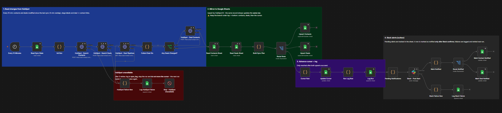
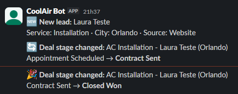
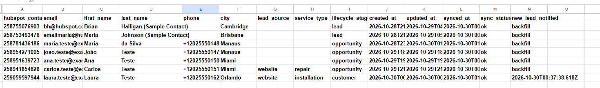
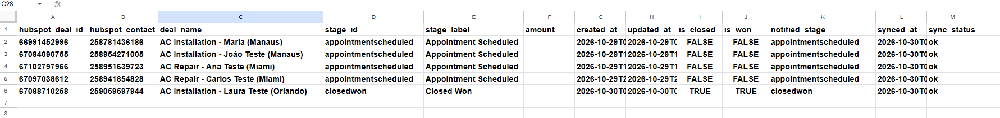
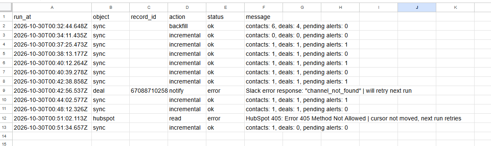

# CRM Sync — HubSpot to Google Sheets + Slack Alerts (n8n)

> **Independent demo project.** "CoolAir" is a fictional air-conditioning company and every record shown here is synthetic. No real customer data was used.

Keeps a **Google Sheets mirror** of the HubSpot CRM up to date and tells the sales team in **Slack** when a new lead arrives or a deal moves to another stage. Each change updates the **same row** in the sheet, and each alert is sent **once**, even when Slack or HubSpot fails along the way.



## Problem

After [LeadFlow](../project-01-leadflow/) puts leads into HubSpot, the business still has two gaps:

- the owner wants the numbers in a **spreadsheet** (for reports and the Project 3 dashboard) without exporting by hand;
- the sales team only notices new leads and deal changes when someone opens the CRM.

A naive "on every run, append rows and post to Slack" automation creates duplicate rows, repeats alerts and silently loses data when an API is down.

## Solution

```text
Every 10 minutes
   │
   ├─ Read the cursor (last successful sync) from the sheet
   │
   ├─ HubSpot: contacts and deals modified since the cursor (5 min overlap),
   │           deal stage labels, deal → contact links
   │     └─ any HubSpot error (after 3 tries) ──> log to sync_log, stop, cursor NOT moved
   │
   ├─ Compare with the sheet and upsert by HubSpot ID
   │     contacts tab  ← one row per contact
   │     deals tab     ← one row per deal
   │
   ├─ Move the cursor forward + write a run summary to sync_log
   │
   └─ Slack #sales-alerts: new leads and deal stage changes still pending
         ├─ sent ──> mark the row as notified
         └─ failed ─> log to sync_log, keep pending, retry next run
```

**HubSpot is the source of truth.** The sheet is a read-only mirror: the workflow overwrites it on every change.

## Stack

| Tool | Role |
|---|---|
| **n8n** (self-hosted, Docker) | Schedule, orchestration, comparison logic, retries, error routing |
| **HubSpot CRM** (free) | Contacts and deals, read through the REST API (CRM v3 search, pipelines, associations v4) |
| **Google Sheets** | Mirror tables, sync cursor and run log |
| **Slack** (free plan) | `#sales-alerts` channel, posted to by a bot with only the `chat:write` scope |

## Slack alerts



| Event | Message |
|---|---|
| New contact created in HubSpot | 🆕 **New lead:** name, service, city, source |
| Deal moved to another stage | 🔄 **Deal stage changed:** old stage → new stage |
| Deal moved to Closed Won | 🎉 **Deal stage changed:** … → **Closed Won** |

## Google Sheets mirror

| Tab | Key | Content |
|---|---|---|
| `contacts` | `hubspot_contact_id` | email, name, phone, city, lead source, service type, lifecycle stage, dates, `new_lead_notified` |
| `deals` | `hubspot_deal_id` | contact ID, deal name, stage ID and label, amount, dates (including `closed_at` for closed deals), closed/won flags, `notified_stage` |
| `sync_state` | `key` | `last_synced_at`: the cursor |
| `sync_log` | — | one row per run, plus one row per failure |




## Design decisions

### Polling instead of HubSpot webhooks

HubSpot webhooks require a public app and a public endpoint. A 10-minute poll works on the free plan, with no inbound traffic, and is easy to replay. Alerts arrive up to ~10 minutes after the change, which is fine for a small sales team.

### A cursor that only moves after success

The last successful sync time is stored in `sync_state`. Each run reads changes since that time minus a **5-minute overlap** (HubSpot's search index can lag a few seconds behind writes). The cursor is written **only after both upserts succeed**, so a failed run is simply repeated by the next one. The overlap may re-read a record, which is harmless because every write is an upsert.

### Upsert by HubSpot ID

Rows are matched by `hubspot_contact_id` / `hubspot_deal_id`, never by email or name. Re-running the workflow, or reading the same record twice, updates the existing row instead of adding a new one.

### Alerts as an outbox, tracked in the sheet

Whether an alert was delivered is stored next to the data:

- `contacts.new_lead_notified`: empty means "new lead alert pending", a timestamp means "sent";
- `deals.notified_stage`: the last stage the team was told about. If it differs from `stage_id`, an alert is pending.

A row is marked as notified **only after Slack confirms the message**. If Slack fails, the alert stays pending and is sent on the next run. Because pending alerts are computed from the sheet (not only from this run's changes), nothing is lost even if the HubSpot record doesn't change again.

### First run = backfill, no alerts

On the first run the cursor is empty: the workflow copies everything that already exists and marks it as `backfill`, so the team is not flooded with alerts for old records.

## Reliability

| Concern | How it is handled |
|---|---|
| Duplicate rows | Upsert by HubSpot ID; re-runs and the 5-minute overlap never add rows. |
| Repeated alerts | Alert state is stored per row and updated only after Slack confirms. |
| Slack down / wrong channel | Error is logged (`channel_not_found`, etc.), alert stays pending and is retried next run. |
| HubSpot down / auth error | 3 retries, then the error is logged in a short readable form, the run stops and the cursor does not move. |
| Large result sets | HubSpot search is paginated with the `after` cursor. |
| Missed changes | The cursor only moves after a successful write, with a 5-minute overlap. |
| Secrets | HubSpot key and Slack bot token live only in n8n credentials. The spreadsheet ID is not in this repository. |

## Test scenarios

All tests were run with synthetic data against HubSpot free, Google Sheets and a free Slack workspace.

| # | Scenario | Expected | Result |
|---|---|---|---|
| 1 | First run (empty cursor) | All existing contacts and deals copied, **no** alerts | ✅ Pass |
| 2 | Run again with no changes | No new rows, no alerts | ✅ Pass |
| 3 | New lead submitted through the LeadFlow form | Contact + deal rows added, one 🆕 alert | ✅ Pass |
| 4 | Run again | No repeated alert | ✅ Pass |
| 5 | Deal moved to *Contract Sent* in HubSpot | **Same** deal row updated, one 🔄 alert | ✅ Pass |
| 6 | Slack failure (invalid channel), then fixed | Failure logged, row stays pending, 🎉 alert delivered on the next run | ✅ Pass |
| 7 | HubSpot failure (invalid endpoint) | Failure logged, run stopped, cursor unchanged; next run catches up | ✅ Pass |



## Setup

1. **Google Sheets:** create a spreadsheet with four tabs and these header rows:
   - `contacts`: `hubspot_contact_id, email, first_name, last_name, phone, city, lead_source, service_type, lifecycle_stage, created_at, updated_at, synced_at, sync_status, new_lead_notified`
   - `deals`: `hubspot_deal_id, hubspot_contact_id, deal_name, stage_id, stage_label, amount, created_at, updated_at, is_closed, is_won, notified_stage, synced_at, sync_status, closed_at`
   - `sync_state`: `key, value`, with a second row `last_synced_at` and an empty value
   - `sync_log`: `run_at, object, record_id, action, status, message`
2. **HubSpot:** reuse the service key and **Header Auth** credential from [Project 1](../project-01-leadflow/#setup) (read scopes for contacts and deals are enough here).
3. **Slack:** create a workspace and a `#sales-alerts` channel, create an app with the bot scope `chat:write`, install it, and run `/invite @YourBot` in the channel. Add the `xoxb-` bot token to an n8n **Slack API** credential.
4. **n8n:** import `workflow.example.json`, then:
   - replace `YOUR_SPREADSHEET_ID` in the Google Sheets nodes (or pick the file from the list);
   - select your credentials in the HubSpot, Google Sheets and Slack nodes.
5. Click **Execute workflow** once (backfill), check the sheet, then activate the workflow.

## Limitations

- **Demo, not production.** Built and tested with synthetic data on free plans.
- **Deletions are not mirrored.** A record deleted in HubSpot stays in the sheet; a production version would read archived records or run a periodic full reconciliation.
- **Google Sheets is not a database.** Fine for hundreds or a few thousand rows; larger volumes would use BigQuery or Postgres.
- **Alerts are near real time**, up to ~10 minutes after the change.
- **Only the default deal pipeline's stage labels** were tested.
- Contacts created before the custom properties existed have empty `lead_source` / `service_type`.

## Possible extensions

- HubSpot webhooks (public app) for instant alerts, keeping the poll as a safety net.
- Daily summary message (new leads, deals won, pipeline value).
- Send alerts to Microsoft Teams, Telegram or email instead of Slack — the outbox logic stays the same.
- Mention the deal owner in the Slack message.

## Files

```text
project-02-crm-sync/
  README.md
  workflow.example.json        # n8n export, credentials and spreadsheet ID removed
  screenshots/
```
