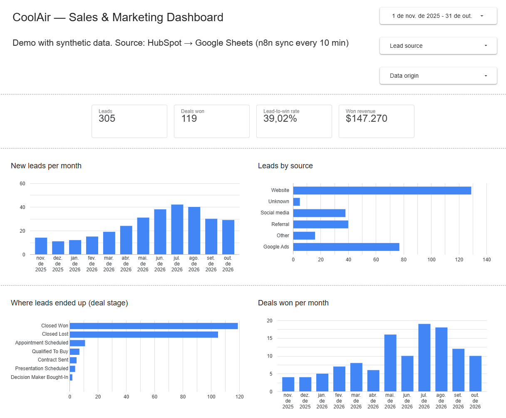
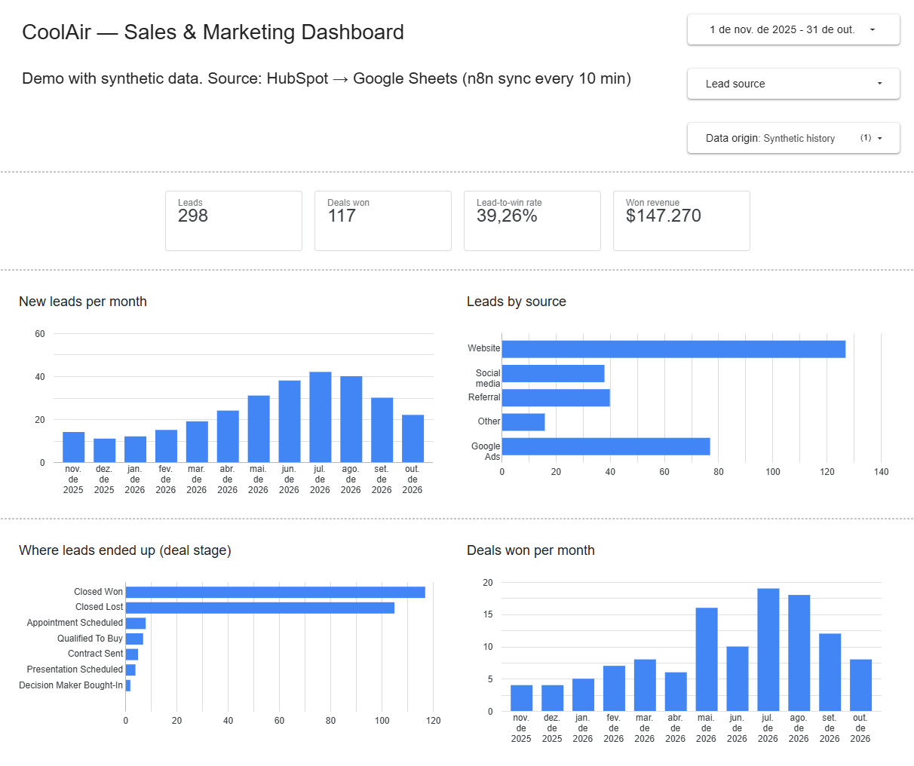
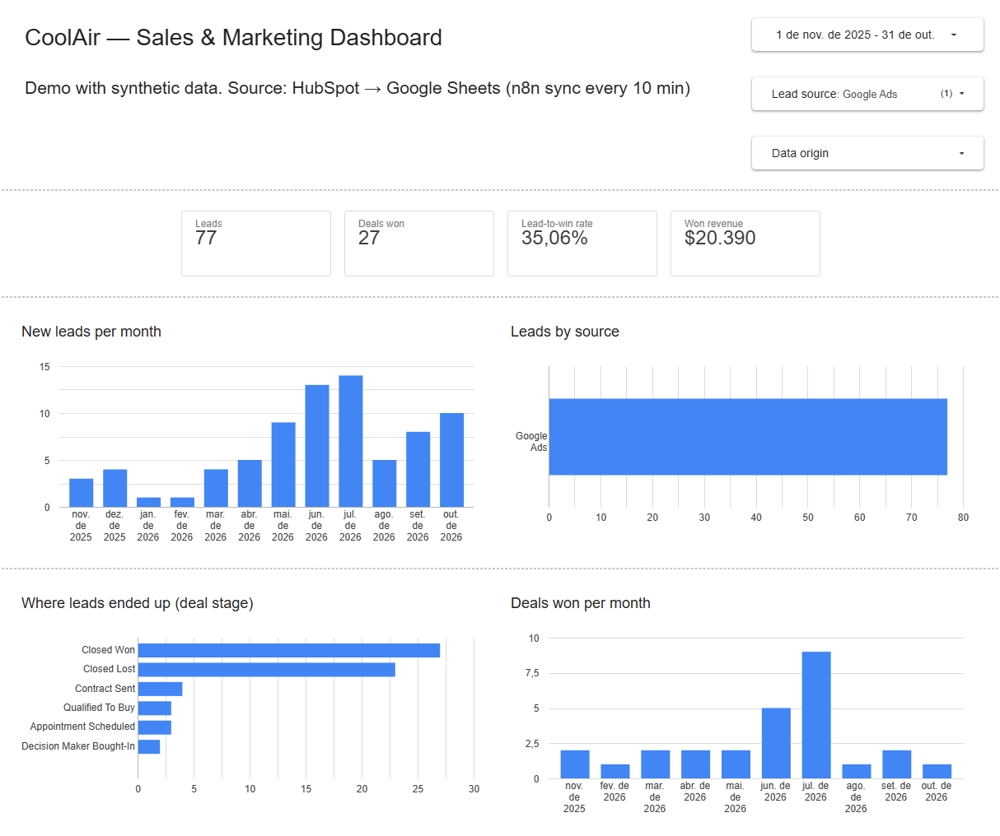

# Sales & Marketing Analytics — Looker Studio Dashboard

> **Independent demo project.** "CoolAir" is a fictional air-conditioning company. The 12-month history is **synthetic** and generated by a script in this folder; the few live records are test leads created through [Project 1](../project-01-leadflow/). No real customer data was used.

A one-page dashboard that answers the owner's questions: **how many leads are coming in, where they come from, how many become customers, and how sales evolve month by month.** It reads the Google Sheets mirror that [Project 2](../project-02-crm-sync/) keeps in sync with HubSpot, so a change in the CRM shows up in the dashboard without any manual export.



## Problem

The business owner has the data in HubSpot but no simple view of the funnel: leads per month, best acquisition channels, conversion and won revenue. Building reports inside the CRM's free plan is limited, and exporting spreadsheets every week is error-prone.

## Solution

```text
[HubSpot CRM] ──n8n sync every 10 min (Project 2)──> [Google Sheets: contacts, deals]
                                                            │
                                     12-month synthetic history appended
                                     (seed rows, flagged sync_status = "seed")
                                                            │
                                                            ▼
                                              [Looker Studio dashboard]
                                     2 blends: contacts ⟕ deals by hubspot_contact_id
```

| Element | What it shows |
|---|---|
| Scorecards | Leads, deals won, lead-to-win rate, won revenue |
| New leads per month | Lead volume and seasonality |
| Leads by source | Which channels bring the most leads |
| Where leads ended up (deal stage) | What happened to the leads of the period (won, lost, still open) |
| Deals won per month | Wins by **close** month |
| Filters | Period, lead source, data origin (synthetic history / live HubSpot) |

## Metric dictionary

| Metric | Definition | Formula (Looker Studio) | Date used by the period filter |
|---|---|---|---|
| **Leads** | Distinct contacts created in the period | `COUNT_DISTINCT(hubspot_contact_id)` | Lead created date |
| **Deals won** | Distinct deals in the *Closed Won* stage, among the leads of the period | `COUNT_DISTINCT(Won deal id)` where `Won deal id = CASE WHEN stage_id = "closedwon" THEN hubspot_deal_id END` | Lead created date |
| **Lead-to-win rate** | Share of the period's leads that became a won deal (cohort view) | `COUNT_DISTINCT(Won deal id) / COUNT_DISTINCT(hubspot_contact_id)` | Lead created date |
| **Won revenue** | Sum of `amount` of won deals among the leads of the period | `SUM(CASE WHEN stage_id = "closedwon" THEN CAST(amount AS NUMBER) ELSE 0 END)` | Lead created date |
| **Deals won per month** | Won deals grouped by the month they were closed | `COUNT_DISTINCT(Won deal id)` by `DATETIME_TRUNC(Close date, MONTH)` | Deal close date |

**Notes on the definitions**

- **Cohort vs. close date.** The scorecards and the first three charts follow the *leads* of the selected period ("what happened to the leads that came in?"). *Deals won per month* follows the *close date* ("how many sales did we close each month?"). A lead from June closed in July counts in June's cohort and in July's wins. Both are correct; they answer different questions.
- **Recent cohorts look worse.** Leads from the last few weeks have not had time to close, so the lead-to-win rate of a recent period is lower than its final value.
- **Won is defined by `stage_id`**, not by the `is_won` column, because the stage ID is always plain text in the sheet.
- **Dates are UTC.** HubSpot timestamps are stored in UTC; a lead created late in the evening (US time) on the last day of a month can fall in the next month.
- **Unknown source** = contacts created before the `lead_source` property existed.

## Design decisions

### Synthetic history in the sheet, not in HubSpot

HubSpot does not let the API set a contact's creation date in the past, so a 12-month history cannot be created there honestly. Instead, `seed/generate-seed.js` writes 298 leads and 248 deals with the **same columns** as the synced tabs, appended to the sheet:

- IDs start with `seed-` and `sync_status = seed`, so they never collide with HubSpot IDs and the Project 2 sync never touches them;
- they are marked as already notified, so they never trigger Slack alerts;
- the **Data origin** filter separates them from live HubSpot records.

The generator is deterministic (same output every run) and models seasonality (summer peak in Florida), channel mix, win rates per service type and realistic deal sizes.

### Blends instead of a pre-joined sheet

Two Looker Studio blends (left outer join on `hubspot_contact_id`) keep the sheet identical to the CRM mirror and avoid formulas that break when the sync rewrites rows:

- **Leads cohort**: `contacts ⟕ deals`, period filter on the lead date;
- **Deals by close date**: `deals ⟕ contacts`, period filter on the close date (lead source still available for filtering).

### Project 2 change: `closed_at`

Monthly wins need the close date, so the Project 2 sync now also reads HubSpot's `closedate` and writes it to a `closed_at` column (only for closed deals; on open deals HubSpot's value is just an expected date).

## Test scenarios

| # | Scenario | Expected | Result |
|---|---|---|---|
| 1 | Counts match the data (no filters, synthetic only) | 298 leads, 117 won, $147,270 — same as the generator's summary | ✅ Pass |
| 2 | Lead source filter (Website, Google Ads) | Website: 127 synthetic + 2 live leads, 47 + 1 won, $61,950. Google Ads: 77 leads, 27 won, $20,390. All match the seed data | ✅ Pass |
| 3 | Filters keep the metric definitions | Rate always equals won ÷ leads of the filtered set (e.g. 117 / 298 = 39.26%) | ✅ Pass |
| 4 | Stage change in HubSpot reaches the dashboard | Test deal moved to *Closed Won* → n8n sync → data refresh: deals won 118 → 119, October wins 9 → 10, Slack alert sent | ✅ Pass |
| 5 | No confidential data exposed | Dashboard shows aggregates only; viewers cannot download, copy or export; the spreadsheet stays private | ✅ Pass |




## Data freshness

- HubSpot → Sheets: every 10 minutes (Project 2 schedule).
- Sheets → Looker Studio: Looker caches Google Sheets data (default freshness ~15 minutes). *View → Refresh data* forces an update.
- End to end, a CRM change appears in the dashboard within about 25 minutes, or immediately after a manual sync and refresh.

## Setup

1. Have the Project 2 sheet running, with a `closed_at` column at the end of the `deals` tab.
2. Generate the history: `node seed/generate-seed.js` → `seed-contacts.csv`, `seed-deals.csv` (synthetic data, safe to share). Remove the header row and append them to the `contacts` and `deals` tabs (*File → Import → Append to current sheet*, with "convert text to numbers, dates and formulas" **off**).
3. In Looker Studio, add both tabs as data sources (IDs as **Text**) and create the calculated fields:
   - contacts: `Lead date = PARSE_DATE("%Y-%m-%d", SUBSTR(created_at, 1, 10))`, `Lead source` (labels via `CASE`), `Data origin = CASE WHEN sync_status = "seed" THEN "Synthetic history" ELSE "Live (HubSpot)" END`
   - deals: `Close date`, `Won deal id`, `Won amount` (see the metric dictionary)
4. Create the two blends, then the scorecards and charts as listed above.
5. Share as *Viewer* with download, print and copy disabled.

## Limitations

- **Mostly synthetic data.** The trends and rates illustrate the method, not a real business.
- **Google Sheets as a data source** works for thousands of rows; larger volumes would use BigQuery.
- **One deal per contact is assumed** in the cohort metrics (true for this dataset because of the Project 1 "one open deal per contact" rule). A contact with several won deals over time would count each deal in *Deals won*.
- **Deletions in HubSpot** are not mirrored (see Project 2).
- **Data refresh is not real time** (see *Data freshness*).

## Possible extensions

- Cost per lead and ROI per channel (needs ad spend data).
- Average time to close, per service type.
- Comparison with the previous period on each scorecard.
- Scheduled PDF email to the owner every Monday.

## Files

```text
project-03-analytics/
  README.md
  seed/
    generate-seed.js           # deterministic generator of the synthetic history
    seed-contacts.csv          # 298 synthetic leads
    seed-deals.csv             # 248 synthetic deals
  screenshots/
```
